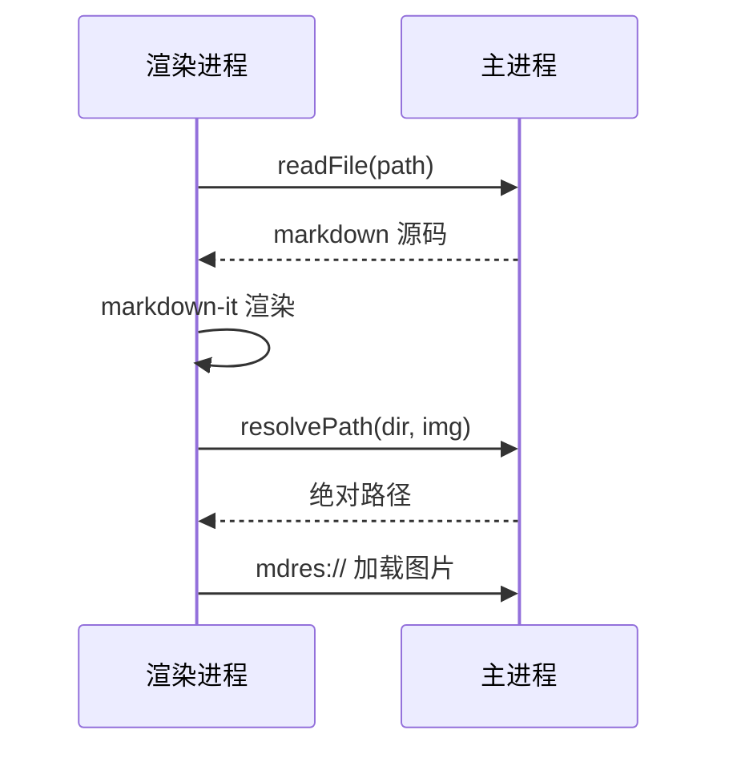

# 代码与图表

## 代码高亮

TypeScript：啦啦啦

```ts
interface TreeNode {
  name: string
  path: string
  type: 'dir' | 'file'
}

export function findNode(tree: TreeNode[], target: string): TreeNode | null {
  for (const node of tree) {
    if (node.path === target) return node
    if (node.children) {
      const found = findNode(node.children, target)
      if (found) return found
    }
  }
  return null
}
```

Python：

```python
def fib(n: int) -> int:
    if n < 2:
        return n
    return fib(n - 1) + fib(n - 2)

print([fib(i) for i in range(10)])
```

Bash：

```bash
# 安装依赖并启动开发模式
npm install
npm run dev
```

无语言标注的代码块按纯文本显示：

```
plain text block
```

## Mermaid 图表

### 流程图


### 时序图


